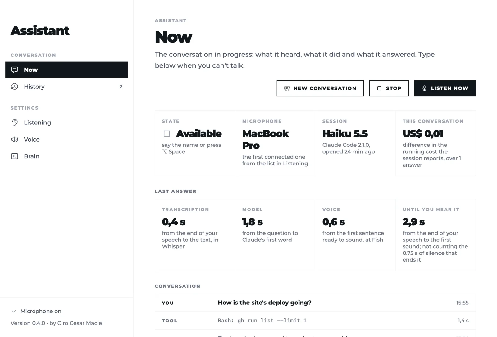

# Assistant by Ciro Cesar Maciel

**A voice assistant for Claude Code: say its name, ask out loud, and it answers by voice while it works in your repositories.**

One of [six free, open-source Mac apps](#more-from-ciro-cesar-maciel) by [Ciro Cesar Maciel](https://ciromaciel.click/?ref=oss-voice-assistant).

**[Watch the 1-minute video](https://youtu.be/NZXiCfgTG7Y)**



Speech is transcribed on your Mac by a local Whisper; the audio never leaves it. Each request goes to one Claude Code session that stays open all day, and the answer is spoken sentence by sentence as it streams. A menu bar app for macOS 14+ on Apple Silicon, with the voice loop written in TypeScript on Bun.

[Português](README.pt-BR.md) · [The page](https://ciromaciel.click/tools/voice-assistant?ref=oss-voice-assistant)

## Install

```bash
curl -fsSL https://blob.ciromaciel.click/tools/voice-assistant/install.sh | bash
```

The script downloads the latest `.dmg`, copies Assistant to `/Applications` and opens it. Prefer the disk image? [Download Assistant-macos.dmg](https://blob.ciromaciel.click/tools/voice-assistant/latest/Assistant-macos.dmg). It is signed with Developer ID and notarized by Apple.

With [Homebrew](https://github.com/ciro-maciel/homebrew-tap), which also installs sox, whisper-cpp and ffmpeg: `brew install --cask ciro-maciel/tap/ciro-voice-assistant`.

Assistant drives tools you install once:

```bash
brew install sox whisper-cpp ffmpeg       # microphone, local Whisper, audio playback
scripts/download-model.sh large-v3-turbo  # or tiny, base, small, medium (from a clone of this repository)
```

and [Claude Code](https://docs.anthropic.com/en/docs/claude-code), signed in. On first launch, allow the microphone.

## How you talk to it

| You | Assistant |
| --- | --- |
| "Assistant, what is the status of the deploy?" | answers right away |
| "Assistant" alone | plays a sound and waits 8 seconds for the request |
| a reply after it finishes speaking | accepted without the name for 60 seconds |
| "Assistant" while it speaks or works | stops at once and listens |
| anything else | goes to a draft; say "go ahead" ("pode fazer" in Portuguese) to run it, or the name |

Before using a tool it says what it is about to do. Reading, searching and editing local files it does without asking. Push, deploy, publish, messaging someone, deleting and paying wait for your spoken yes in that conversation; the list is yours to change in the app.

English and Brazilian Portuguese, following the Mac's language: the interface, the spoken phrases, the voice rules and the prompts sent to Claude. The `language` key in the config sets the conversation's language apart from the Mac's.

## How it works

```
microphone ─ app (echo cancelled) or sox ─> engine/src/ear.ts ─ whisper-server (local) ─> text
text ─> conversation.ts: has the name? is the window open? is it my own echo? is it for me?
request ─> brain.ts: one Claude Code session kept open (stream-json)
streaming answer ─> sentences.ts: sentence by sentence ─> mouth.ts: Fish Audio or the Mac's voice
```

- **Ear.** Utterances are cut by energy with an adaptive noise floor. Whisper's hallucinations on silence are dropped. With the app running, macOS voice processing removes the assistant's own voice from the microphone, so you can interrupt it over the speakers.
- **Brain.** `claude -p` in streaming mode, in the folder you choose, with the extra folders you add. Same day, same session: it is resumed after a restart. When a conversation ends, a one-shot Claude Code writes a short summary into a local journal that the next session reads.
- **Is this for me?** Without the name, a small model reads the utterance and the last exchanges and decides whether you were talking to it (after Mallidi et al., *Device-directed Utterance Detection*, 2018). No means it stays in the draft, never lost.
- **Mouth.** With a [Fish Audio](https://fish.audio) key and voice id, each sentence is synthesized up to two ahead of the one playing. Without them, the Mac's own voice speaks.
- **Panel.** <http://localhost:4780> shows what it heard (and what it ignored, and why), the tools it runs and what each answer cost. You can type instead of talking there.

## What leaves your Mac

| Goes out | To |
| --- | --- |
| The text of your requests and the files Claude Code reads | Anthropic, through your Claude Code |
| The text of each spoken sentence, only if you configure Fish | Fish Audio |

Your voice, the recordings and the transcripts stay on the Mac: history, journal and session live in `~/Library/Application Support/voice-assistant`.

## Configure

Everything personal is in one file outside the repository, `~/.config/voice-assistant/config.json` (or the path in `VOICE_ASSISTANT_CONFIG`). Every key is optional; [`config.example.json`](config.example.json) has them all.

| Key | What it does | Default |
| --- | --- | --- |
| `language` | The conversation's language: `"en"` or `"pt-BR"` (voice rules, spoken phrases, Whisper's default) | the Mac's language (pt → Portuguese, else English) |
| `wakeWords` | The name first, then how Whisper mishears it | `["assistant"]`; in Portuguese `["assistant", "assistente"]` |
| `userName` | How the instructions refer to you | "the person" |
| `workingDir` | Where the Claude Code session runs (its `CLAUDE.md`) | your home folder |
| `folders` | Extra folders it may read and edit (`--add-dir`) | none |
| `instructions` | Lines appended to the voice rules | none |
| `inputPreference` | Microphones by name, first connected wins | system default |
| `whisperModelsDir`, `whisperModel`, `whisperLanguage`, `whisperPrompt` | Local Whisper | `…/voice-assistant/models`, `large-v3-turbo`, the conversation's language (`en` or `pt`) |
| `fishVoiceId`, `voiceName`, `voiceSpeed`, `fishModel` | Fish Audio voice | none (Mac voice), 1.0, `s2.1-pro` |
| `fishApiKeyFile` | A dotenv file with `FISH_API_KEY=` for when the app has no shell environment | none |
| `fallbackVoice` | The Mac voice (`say -v ?`) | Samantha; in Portuguese, Luciana |
| `brainModel` | Claude model of the conversation | `claude-haiku-5-5` |
| `dataDir` | History, journal, session and the app's settings | `~/Library/Application Support/voice-assistant` |

Environment variables win over the file: `FISH_API_KEY`, `FISH_VOICE_ID`, `ASSISTANT_MODEL`, `ASSISTANT_INPUT` (a microphone by name) and `ASSISTANT_CLAUDE` (the `claude` binary). The app's Settings screens change microphone, Whisper model, voice, model, folders and confirmations live, and save them in `dataDir/settings.json`.

## The spoken summary hook (optional)

[`hook/speak.sh`](hook/speak.sh) gives a voice to your ordinary Claude Code sessions too. As a `Stop` hook, it reads the end of each answer and speaks a marker like `<!-- voz: Terminei e subi a correção. -->` (or `voice:`), with the same voice settings. No marker, no sound; `touch ~/.claude/voice/off` silences it.

```json
{ "hooks": { "Stop": [ { "hooks": [ { "type": "command", "command": "/path/to/voice-assistant/hook/speak.sh", "async": true, "timeout": 10 } ] } ] } }
```

Then tell Claude, in your `CLAUDE.md`, to end finished tasks with that marker in one to three spoken sentences. `bun hook/player/server.ts` opens a local player at <http://127.0.0.1:4777> with every line said, to replay. Inside the assistant's own session the hook stays quiet.

## Build it yourself

You need the Xcode Command Line Tools and [Bun](https://bun.sh).

```bash
git clone https://github.com/ciro-maciel/voice-assistant.git
cd voice-assistant
scripts/build.sh                 # dist/Assistant.app, with Bun and the engine inside
open dist/Assistant.app
```

Or run only the engine, from a terminal that has microphone permission (Terminal.app):

```bash
cd engine && bun start           # panel on http://localhost:4780
bun test                         # wake word, echo, conversation windows, sentences, memory
```

`scripts/build.sh` signs with a Developer ID Application certificate when your keychain has one. Otherwise `scripts/signing-identity.sh` creates a local signing certificate once: with it, the microphone permission survives each rebuild; without it, the build is signed ad hoc and macOS asks again every time. `scripts/dist.sh` bumps the version, packs a `.dmg` and installs it in `/Applications`.

## Limits

- Apple Silicon and macOS 14 or newer only.
- English and Brazilian Portuguese only, following the Mac's language.
- One model talks and works: during a long task it says what it will do and goes quiet until it ends.
- It does not start at login.

## Contributing

Issues and pull requests are welcome. See [CONTRIBUTING.md](CONTRIBUTING.md).

## License

[MIT](LICENSE). Fonts and icons keep their own licenses: see [NOTICE](NOTICE).

---

## More from Ciro Cesar Maciel

I build software on my own, with a team of AI agents, and open what I can. Six native Mac apps, all free, MIT, signed and notarized by Apple, in English and Brazilian Portuguese: [Cleaner](https://github.com/ciro-maciel/cleaner), the Mac cleaner that shows you everything before it deletes anything · [Screenshots](https://github.com/ciro-maciel/screenshots), capture, annotate and record the screen, with nothing leaving your Mac · [Speech to Text](https://github.com/ciro-maciel/speech-to-text), dictation by shortcut, with Whisper running on your Mac · [Assistant](https://github.com/ciro-maciel/voice-assistant), Claude Code by voice (this one) · [Windows](https://github.com/ciro-maciel/windows), snap windows into place with a shortcut or by dragging them to the edge · [Text to Speech](https://github.com/ciro-maciel/text-to-speech), select text in any app and hear it read aloud.

Beyond the apps: [free tools for the browser](https://ciromaciel.click/tools?ref=oss-voice-assistant), [books](https://ciromaciel.click/books?ref=oss-voice-assistant), and [Infrastructure](https://myinfrastructure.click/?ref=oss-voice-assistant), the infrastructure AI agents already know how to run.

**Follow along.** [Follow @ciro-maciel](https://github.com/ciro-maciel) for the next open-source apps, click **Watch → Custom → Releases** above for every new version, and see how it is all made on [YouTube](https://www.youtube.com/@ciro-maciel) and at [ciromaciel.click](https://ciromaciel.click/?ref=oss-voice-assistant).
