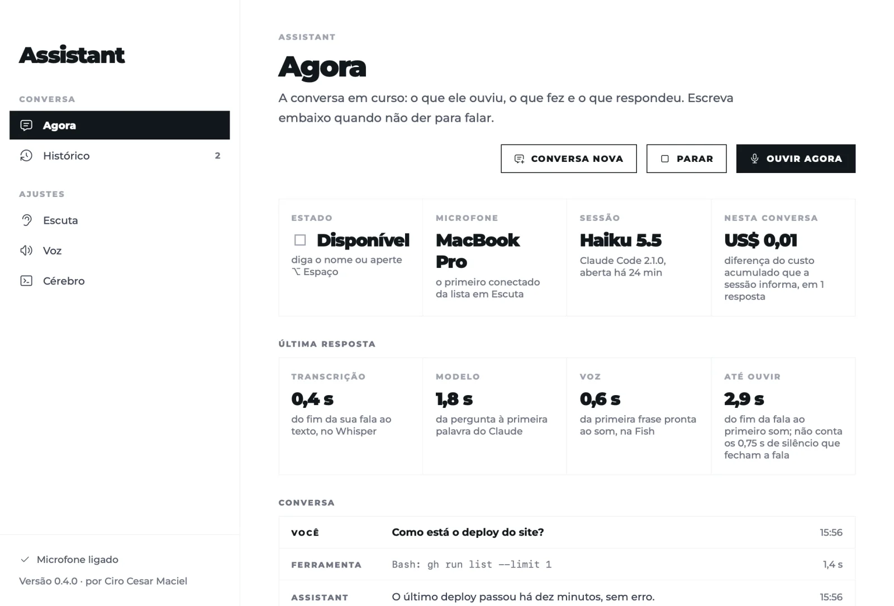

# Assistant by Ciro Cesar Maciel

**Um assistente de voz para o Claude Code: diga o nome dele, peça em voz alta, e ele responde falando enquanto trabalha nos seus repositórios.**

Um dos [seis apps de Mac grátis e de código aberto](#mais-de-ciro-cesar-maciel) de [Ciro Cesar Maciel](https://ciromaciel.click/?ref=oss-voice-assistant).

**[Veja o vídeo de 1 minuto](https://youtu.be/NZXiCfgTG7Y)** (em inglês)

[](https://www.opensourcealternatives.to)



A fala é transcrita no seu Mac por um Whisper local; o áudio nunca sai dele. Cada pedido vai para uma sessão do Claude Code que fica aberta o dia todo, e a resposta é falada frase por frase, enquanto chega. Um app de barra de menus para macOS 14+ em Apple Silicon, com o motor de voz em TypeScript sobre o Bun.

[English](README.md) · [A página](https://ciromaciel.click/tools/voice-assistant?ref=oss-voice-assistant)

## Instalar

```bash
curl -fsSL https://blob.ciromaciel.click/tools/voice-assistant/install.sh | bash
```

O script baixa o `.dmg` mais recente, copia o Assistant para `/Applications` e abre. Prefere a imagem de disco? [Baixe o Assistant-macos.dmg](https://blob.ciromaciel.click/tools/voice-assistant/latest/Assistant-macos.dmg). Ele é assinado com Developer ID e notarizado pela Apple.

Com o [Homebrew](https://github.com/ciro-maciel/homebrew-tap), que também instala sox, whisper-cpp e ffmpeg: `brew install --cask ciro-maciel/tap/ciro-voice-assistant`.

O Assistant usa ferramentas que você instala uma vez:

```bash
brew install sox whisper-cpp ffmpeg       # microfone, Whisper local, reprodução de áudio
scripts/download-model.sh large-v3-turbo  # ou tiny, base, small, medium (de um clone deste repositório)
```

e o [Claude Code](https://docs.anthropic.com/en/docs/claude-code), com login feito. Na primeira abertura, libere o microfone.

## Como conversar

| Você | O Assistant |
| --- | --- |
| "Assistant, qual é o status do deploy?" | responde direto |
| "Assistant" sozinho | toca um som e espera o pedido por 8 segundos |
| responde depois que ele termina de falar | aceita sem o nome por 60 segundos |
| "Assistant" enquanto ele fala ou trabalha | para na hora e escuta |
| qualquer outra coisa | vai para um rascunho; diga "pode fazer" (em inglês, "go ahead") para executar, ou o nome |

Antes de usar uma ferramenta, ele diz o que vai fazer. Ler, pesquisar e editar arquivos locais ele faz sem perguntar. Push, deploy, publicar, mandar mensagem a alguém, apagar e pagar esperam o seu sim falado naquela conversa; a lista é sua para mudar no app.

Inglês e português do Brasil, seguindo o idioma do Mac: a interface, as frases faladas, as regras de fala e os prompts enviados ao Claude. A chave `language` da configuração define o idioma da conversa separado do Mac.

## Como funciona

```
microfone ─ app (eco cancelado) ou sox ─> engine/src/ear.ts ─ whisper-server (local) ─> texto
texto ─> conversation.ts: tem o nome? a janela está aberta? é eco da minha voz? é para mim?
pedido ─> brain.ts: uma sessão do Claude Code aberta o tempo todo (stream-json)
resposta em streaming ─> sentences.ts: frase por frase ─> mouth.ts: Fish Audio ou a voz do Mac
```

- **Ouvido.** As falas são cortadas por energia, com piso de ruído adaptativo. As alucinações do Whisper no silêncio são descartadas. Com o app aberto, o processamento de voz do macOS tira a voz do próprio assistente do microfone, então dá para interromper com o som saindo pelo alto-falante.
- **Cérebro.** `claude -p` em modo streaming, na pasta que você escolher, com as pastas extras que você adicionar. No mesmo dia, a mesma sessão: ela é retomada depois de reiniciar. Quando uma conversa termina, um Claude Code avulso escreve um resumo curto num diário local que a próxima sessão lê.
- **É para mim?** Sem o nome, um modelo pequeno lê a frase e as últimas trocas e decide se você falava com ele (a partir de Mallidi et al., *Device-directed Utterance Detection*, 2018). Não sendo, a frase fica no rascunho, nunca se perde.
- **Boca.** Com chave e id de voz da [Fish Audio](https://fish.audio), cada frase é sintetizada até duas à frente da que está tocando. Sem eles, fala a voz do próprio Mac.
- **Painel.** <http://localhost:4780> mostra o que ele ouviu (e o que ignorou, e por quê), as ferramentas que usa e quanto custou cada resposta. Lá também dá para escrever em vez de falar.

## O que sai do seu Mac

| Sai | Para |
| --- | --- |
| O texto dos seus pedidos e os arquivos que o Claude Code lê | Anthropic, pelo seu Claude Code |
| O texto de cada frase falada, só se você configurar a Fish | Fish Audio |

Sua voz, as gravações e as transcrições ficam no Mac: histórico, diário e sessão moram em `~/Library/Application Support/voice-assistant`.

## Configurar

Tudo o que é pessoal fica num arquivo fora do repositório, `~/.config/voice-assistant/config.json` (ou o caminho em `VOICE_ASSISTANT_CONFIG`). Toda chave é opcional; o [`config.example.json`](config.example.json) tem todas.

| Chave | O que faz | Padrão |
| --- | --- | --- |
| `language` | O idioma da conversa: `"en"` ou `"pt-BR"` (regras de fala, frases faladas, padrão do Whisper) | o idioma do Mac (pt → português, senão inglês) |
| `wakeWords` | O nome primeiro, depois como o Whisper o escuta errado | `["assistant", "assistente"]`; em inglês `["assistant"]` |
| `userName` | Como as instruções se referem a você | "a pessoa" |
| `workingDir` | Onde a sessão do Claude Code roda (o `CLAUDE.md` dela) | sua pasta pessoal |
| `folders` | Pastas extras que ele pode ler e editar (`--add-dir`) | nenhuma |
| `instructions` | Linhas somadas às regras de fala | nenhuma |
| `inputPreference` | Microfones por nome, vence o primeiro conectado | o padrão do sistema |
| `whisperModelsDir`, `whisperModel`, `whisperLanguage`, `whisperPrompt` | Whisper local | `…/voice-assistant/models`, `large-v3-turbo`, o idioma da conversa (`pt` ou `en`) |
| `fishVoiceId`, `voiceName`, `voiceSpeed`, `fishModel` | Voz da Fish Audio | nenhuma (voz do Mac), 1.0, `s2.1-pro` |
| `fishApiKeyFile` | Um arquivo dotenv com `FISH_API_KEY=` para quando o app não tem o ambiente do shell | nenhum |
| `fallbackVoice` | A voz do Mac (`say -v ?`) | Luciana; em inglês, Samantha |
| `brainModel` | Modelo do Claude na conversa | `claude-haiku-5-5` |
| `dataDir` | Histórico, diário, sessão e os ajustes do app | `~/Library/Application Support/voice-assistant` |

Variáveis de ambiente vencem o arquivo: `FISH_API_KEY`, `FISH_VOICE_ID`, `ASSISTANT_MODEL`, `ASSISTANT_INPUT` (um microfone pelo nome) e `ASSISTANT_CLAUDE` (o binário `claude`). As telas de Ajustes do app trocam microfone, modelo do Whisper, voz, modelo, pastas e confirmações na hora, e guardam em `dataDir/settings.json`.

## O hook do resumo falado (opcional)

O [`hook/speak.sh`](hook/speak.sh) dá voz também às suas sessões comuns do Claude Code. Como hook de `Stop`, ele lê o fim de cada resposta e fala um marcador como `<!-- voz: Terminei e subi a correção. -->` (ou `voice:`), com os mesmos ajustes de voz. Sem marcador, sem som; `touch ~/.claude/voice/off` silencia.

```json
{ "hooks": { "Stop": [ { "hooks": [ { "type": "command", "command": "/caminho/para/voice-assistant/hook/speak.sh", "async": true, "timeout": 10 } ] } ] } }
```

Depois peça ao Claude, no seu `CLAUDE.md`, que termine as tarefas com esse marcador em uma a três frases faladas. `bun hook/player/server.ts` abre um player local em <http://127.0.0.1:4777> com cada linha dita, para ouvir de novo. Dentro da sessão do próprio assistente o hook fica calado.

## Compilar você mesmo

Você precisa das Command Line Tools do Xcode e do [Bun](https://bun.sh).

```bash
git clone https://github.com/ciro-maciel/voice-assistant.git
cd voice-assistant
scripts/build.sh                 # dist/Assistant.app, com o Bun e o motor dentro
open dist/Assistant.app
```

Ou rode só o motor, num terminal com permissão de microfone (Terminal.app):

```bash
cd engine && bun start           # painel em http://localhost:4780
bun test                         # nome, eco, janelas da conversa, frases, memória
```

O `scripts/build.sh` assina com um certificado Developer ID Application quando o seu chaveiro tem um. Se não tiver, o `scripts/signing-identity.sh` cria uma vez um certificado local: com ele, a permissão do microfone sobrevive a cada build; sem ele, o build é assinado ad hoc e o macOS pergunta de novo toda vez. O `scripts/dist.sh` sobe a versão, gera um `.dmg` e instala em `/Applications`.

## Limites

- Só Apple Silicon e macOS 14 ou mais novo.
- Só inglês e português do Brasil, seguindo o idioma do Mac.
- Um modelo só conversa e trabalha: numa tarefa longa, ele diz o que vai fazer e fica em silêncio até terminar.
- Não abre sozinho no login.

## Contribuir

Issues e pull requests são bem-vindos. Veja o [CONTRIBUTING.md](CONTRIBUTING.md).

## Licença

[MIT](LICENSE). Fontes e ícones mantêm as próprias licenças: veja o [NOTICE](NOTICE).

---

## Mais de Ciro Cesar Maciel

Eu construo software sozinho, com uma equipe de agentes de IA, e abro o que dá para abrir. Seis apps nativos para Mac, todos grátis, MIT, assinados e notarizados pela Apple, em inglês e português do Brasil: [Cleaner](https://github.com/ciro-maciel/cleaner), o limpador de Mac que mostra tudo antes de apagar qualquer coisa · [Screenshots](https://github.com/ciro-maciel/screenshots), captura, anotação e gravação de tela, sem nada sair do Mac · [Speech to Text](https://github.com/ciro-maciel/speech-to-text), ditado por atalho, com o Whisper rodando no Mac · [Assistant](https://github.com/ciro-maciel/voice-assistant), o Claude Code por voz (este) · [Windows](https://github.com/ciro-maciel/windows), janelas no lugar com um atalho ou levando até a borda · [Text to Speech](https://github.com/ciro-maciel/text-to-speech), selecione um texto em qualquer app e ouça.

Além dos apps: [ferramentas grátis no navegador](https://ciromaciel.click/tools?ref=oss-voice-assistant), [livros](https://ciromaciel.click/books?ref=oss-voice-assistant) e o [Infrastructure](https://myinfrastructure.click/?ref=oss-voice-assistant), a infraestrutura que os agentes já sabem operar.

**Toda semana, por e-mail:** as [Cartas do Ciro](https://ciromaciel.click/?ref=oss-voice-assistant), o que estou construindo e aprendendo.

**Acompanhe.** [Siga @ciro-maciel](https://github.com/ciro-maciel) para os próximos apps abertos, clique em **Watch → Custom → Releases** aqui em cima para saber de cada versão nova, e veja como tudo é feito no [YouTube](https://www.youtube.com/@ciro-maciel).
